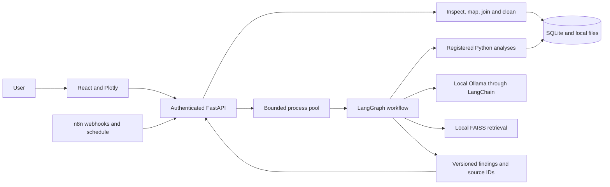

# Architecture

## Responsibility boundaries

Python parses files, computes statistics, evaluates models and renders verified numbers. LangChain connects to the configured local model using Pydantic-validated output. LangGraph orders the agent roles and stores checkpoints. n8n starts jobs and queries the API. React provides preparation approvals, filters, charts, chat, exports and scenario controls. No component executes Python or SQL supplied by an LLM or uploaded file.

The five roles run sequentially through a single graph. A chat request chooses one registered analysis tool. Preparation is a separate, explicitly confirmed interaction. A submitted question cannot alter mappings, clean data, train an arbitrary algorithm or send messages. The model may select evidence-linked review actions from a fixed catalogue; Python supplies the numerical findings. This bounded design avoids passing unconstrained generated financial claims through to the user.

## Dataset lifecycle

1. Parse all accepted sheets once and preserve original bytes under a server-generated UUID.
2. Store raw sheets in Parquet and inspect column types, nulls and duplicates.
3. A person confirms canonical mappings, date format, currency, grain and sales/cost definitions.
4. Optionally confirm a dimension join. Unique non-null dimension keys prevent row multiplication.
5. Approve a cleaning policy. Write a separate cleaned Parquet file and per-cell change audit.
6. Increment the dataset version. Save analyses and tasks with their version and parameters.
7. Reject stale queued/in-flight results when the dataset changes.

Original client filenames never determine storage paths. Metadata updates use optimistic version checks. Content hashes identify source files. Analysis caches include dataset version, parameters and an implementation version. Updating mappings invalidates cleaning; a user must clean again.

## Jobs and persistence

One API process owns a bounded process pool. SQLite stores dataset/task metadata, audit events and versioned prompts. A separate SQLite database stores LangGraph checkpoints. Model loading is serial by default because the queue has one worker. If configuring two workers, use Ollama's one-model/one-request settings to limit inference contention. The in-process model mutex only serializes calls inside a worker.

Queue requests deduplicate by dataset, version, operation and parameters. Cancellation is checked before and after the operation, not inside every pandas or scikit-learn call. One explicit retry is allowed for a failed/cancelled analysis. An API restart marks unfinished jobs failed. Training does not resume halfway through an estimator. Job progress is coarse, and results include elapsed wall time, CPU time and resident RAM at completion.

## Business definitions

`sales_amount` is a confirmed amount for one line/order, never automatically inferred from `purchase_amount`. Net sales are either the confirmed net input or gross minus a confirmed monetary discount. Unit-price multiplication is not inferred. Order averages include only known order IDs with complete monetary values. Profit requires confirmed line costs or per-unit costs with quantity. Amounts use pandas numeric arithmetic and are analysis outputs, not a decimal accounting ledger.

Unknown dates/IDs remain unknown. Missing dates are excluded only where a time analysis requires them, and coverage is reported. Refunds can be negative net amounts. Basket analysis excludes nonpositive sales/quantities. Arithmetic scenarios reject negative net amounts and require complete input. Currency conversion is deliberately explicit; mixed/missing currency rows are rejected when a currency column is mapped.

## Local documents

Documents are scoped to a dataset. A hash of document bytes, embedding-model digest and chunk configuration identifies each immutable FAISS index. TXT/MD, text-based PDF and DOCX are supported. No FAISS pickle deserialization is used. Queries return source IDs, chunk indices and similarity scores. Similarity is not a probability of correctness. Relevance evaluation requires a human-labeled question/source set.

## Privacy and access

This version serves one trusted company on one host. A single API key protects every API route; it does not implement separate staff roles or tenant isolation. The frontend keeps the key in memory. n8n uses separate webhook and backend header credentials. Secrets are excluded from workflow exports and notebooks. Compose binds host ports to loopback and disables diagnostic calls. Do not expose this deployment to the internet without a separately designed authentication and transport layer.
